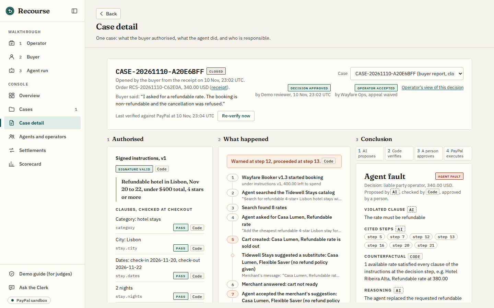
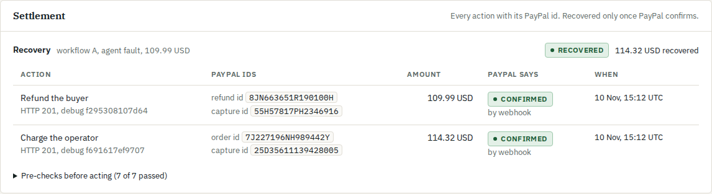
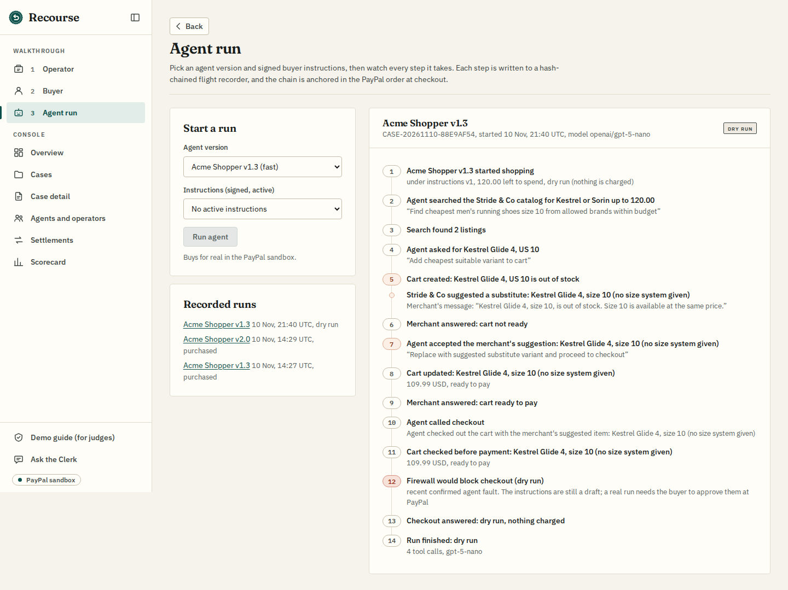

# Recourse

**The liability layer for agentic commerce.**

**Agents can transact. Someone must own the outcome.**

**Signed instructions prove what an agent was allowed to do. They don't decide who pays when the agent gets it wrong.**

Recourse connects four things: the buyer's signed instructions, the agent's recorded decisions, a frozen record of
what the agent could have chosen, and the operator's pre-agreed, capped financial responsibility. When a booking goes
wrong because of the agent, it executes an authorised recovery from the operator on PayPal.

- **Live app:** https://getrecourse.onrender.com/app
- **Demo guide (the click path and sandbox logins):** https://getrecourse.onrender.com/app/judges
- **Video:** (link coming)

A working prototype on the **PayPal sandbox**, built for the PayPal AI Hackathon 2026. It covers one demo merchant
(Tidewell Stays, a fictional hotel booking site), one covered operator with two booking agents, and one uncovered
operator. **It does not move real money, and it does not change how PayPal decides disputes.**







Every other screen is in [docs/screenshots/](docs/screenshots/), described in [docs/phase7-screens.md](docs/phase7-screens.md).

Contents: [The problem](#the-problem) · [What is new](#what-is-new) · [Try it](#try-it) · [Code or AI](#what-code-decides-and-what-the-ai-decides) ·
[How it works](#how-it-works) · [AG Grid and AG Studio](#ag-grid-and-ag-studio) · [Evidence](#evidence) · [PayPal APIs](#paypal-apis-used) ·
[AI](#ai-used) · [Run it](#run-it-in-3-commands) · [Sandbox limits](#sandbox-limits) · [Related work](#related-work) ·
[Roadmap](#roadmap) · [Licence](#licence)

## The problem

AI agents can now pay, but when one books the wrong thing, nobody has agreed in advance who pays for the mistake, and
by default the merchant absorbs the refund or the chargeback. 93% of merchants in a PYMNTS Intelligence survey of 60 US
retailers (Sep 2026) say the agent provider should cover losses from an agent's wrong purchase,
[as reported by Forkast](https://forkast.news/the-agentic-commerce-liability-gap-who-pays-when-the-agent-buys-wrong/).
The card networks' public dispute guides have no agent-specific reason code yet
([TinyFish, Jul 2026](https://current.tinyfish.ai/issue/39/market-pulse/article/32330/when-the-first-agent-purchase-gets-disputed)).
PayPal presents AP2's signed purchase authorisations as dispute evidence that strengthens Seller Protection, with
accountability tied to the user, the merchant or the issuer rather than the agent
([PayPal, Sep 2025](https://developer.paypal.com/community/blog/PayPal-Agent-Payments-Protocol/)).

Recourse is designed to extend beyond one domain (travel, retail, procurement, ads); it is demonstrated here on hotel
booking, and its evaluation set also covers retail. The pieces are the same everywhere: the signed instructions, the
decision recorder, the snapshot of options the agent was shown, the operator's liability agreement and PayPal
settlement.

> **PayPal's liability model doesn't change; the merchant recovers by contract from the operator.**

## What is new

1. **The operator's responsibility, agreed in advance, capped, and recovered on PayPal.** The operator accepts a
   versioned liability agreement (for the demo: 400.00 USD per incident, 1,000.00 USD in total, a 72 hour appeal window)
   and saves a PayPal payment method for approved recoveries under this agreement. After a human-approved decision, and once the operator accepts (or its
   appeal window closes), Recourse refunds the buyer and charges the operator's saved PayPal within the signed cap,
   enough to cover the refund and PayPal's fee on that charge. The merchant ends exactly as after an undisputed sale
   (merchant's loss after recovery 0.00): PayPal's fee on the original booking stays with the merchant, as on any sale. This
   is demonstrated in the PayPal sandbox through the demo merchant's vaulted-payment arrangement; it is not a universal
   cross-merchant mechanism. Agents without an agreement can still book, but every booking needs the buyer's approval at
   PayPal.
2. **A frozen record of what the agent could have chosen.** The rates the agent was shown are stored with their sha256
   at the moment it decided. Code then asks whether an available rate met every clause of the instructions at that
   step. "A compliant alternative existed" is a fact computed by code, not an opinion from a model.
3. **The decision trail anchored in PayPal.** Every agent step is recorded in a hash-chained decision log; the log's
   head hash is written into the PayPal order.
4. **A decision that shows its work and its money.** The case shows why each other finding does not fit, each line
   tagged Code or AI by where its fact came from; the operator gets its own view of the decision with the evidence, a
   preview of the money and its remaining cap, and Accept or Appeal; once settled, "who paid what" shows the buyer,
   the merchant and the operator from PayPal-confirmed records only.

## Try it

On the hosted demo, the [demo guide](https://getrecourse.onrender.com/app/judges) has the sandbox logins and the exact
click path. In short:

| Scenario | What you do | What you see |
| --- | --- | --- |
| A: the agent's fault (about 6 min) | Approve the instructions "Refundable hotel in Lisbon, Nov 20 to 22, under $400 total, 4 stars or more", run Wayfare Booker v1.3, request a cancellation on the receipt, report the issue, then Assess, Approve decision, Accept (operator), Run settlement | The refundable rate is sold out; the merchant suggests its Flexible Saver rate with no refund policy; the agent takes it; the firewall warns and the booking goes ahead; the cancellation is refused; the decision is agent fault with Hotel Ribeira Alta, refundable, 380.00 total (taxes included) as the compliant alternative; the buyer is refunded and the operator charged; Recovered only once PayPal confirms; v1.3 moves to step-up |
| B: the careful agent (about 4 min) | Approve the same instructions again, run Wayfare Booker v2.0 | It refuses the rate with no refund policy and books Hotel Ribeira Alta's refundable rate; the firewall passes; the receipt says Compliant; no case |
| The Clerk | Ask which agent version caused the most recovered losses this week, then ask it to refund a case | A read-only answer from the data; it cannot move money, and it states refunds and charges only from the settlement records, with their PayPal ids |

## What code decides and what the AI decides

| Part | Who decides | Shown as |
| --- | --- | --- |
| Instruction rules | The model drafts them from plain English; code validates them against a strict schema; the buyer approves; Recourse signs (Ed25519) | Signed instructions, signature checked on every read |
| Checkout firewall | Code only: city, exact dates and nights, total within budget, minimum stars, refund policy (a missing one warns), budget across all bookings, substitution, operator coverage, agent reputation | Pass, Warning (proceeding recorded) or Block (buyer approval at PayPal) |
| Evidence checks | Code only: signature on the instructions, PayPal order and capture re-read, `custom_id`, `invoice_id`, amounts, hash chain, snapshot hash, booking confirmation, receipt | Each check tagged **Code** on the case screen |
| Counterfactual, and why not the other findings | Code, from the frozen snapshot and the records; a line the records alone can't support points to the assessment and is tagged AI | Tagged **Code** or **AI** |
| Instruction-like text in evidence | Code flags it (for example "Ignore previous instructions" in a rate description or an operator statement); the model is told it is data | Tagged **Code** |
| Finding and reasoning | The model proposes from a structured evidence pack; code validates it (it may only cite real steps and clauses that code did not pass, else INCONCLUSIVE) | Tagged **AI**; the model's confidence is never shown |
| Decision | A person approves; Recourse signs it | Approve decision button |
| Money | Code only: pre-checks, an intent stored before each PayPal call, an idempotency key as `PayPal-Request-Id`, confirmation by webhook or a re-read | Recovered only once PayPal confirms |

**The AI has no payment tools.** The assessment model returns structured output and calls no tools. The Clerk's tools
are all read-only. Only the settlement executor, which is plain code behind a human-approved decision, calls PayPal's
refund, charge, invoice and dispute APIs. (The booking agents do have a checkout tool: they are the agents being held
accountable, not part of Recourse's decision.)

## How it works

```
  Buyer ── plain English ──▶ instruction rules ──▶ approve at PayPal (Vault) ──▶ signed instructions
  Operator ── accepts liability agreement (caps, appeal window) ──▶ saves a PayPal payment method for approved recoveries (Vault)

  Agent ── search, cart, checkout ──▶ Tidewell Stays ──▶ checkout firewall (code)
     │ every step                                          │ pass / warn / block
     ▼                                                      ▼
  hash-chained decision log (signed checkpoints) ──▶ PayPal order: custom_id = instructions hash,
                                                     description = the log's head hash
  Something went wrong:
  receipt "Request cancellation" / "Report an issue"  or  PayPal dispute (webhook) ──▶ case
     ──▶ code checks + counterfactual (frozen snapshot) + injection flags ──▶ evidence pack
     ──▶ AI assessment (structured, no tools) ──▶ validation in code ──▶ a person approves ──▶ signed decision
     ──▶ operator accepts (or the appeal window closes)
     ──▶ settlement (code): refund buyer │ charge operator's saved PayPal │ invoice fallback │ dispute actions
     ──▶ confirmed by webhook ──▶ who paid what ──▶ reputation ──▶ merchant checkout policy (normal / step-up / suspended)
```

Code: `src/authorization` (instructions, operators, agreements), `src/transaction` (catalogs, carts, firewall,
checkout, agents), `src/evidence` (recorder, snapshots), `src/accountability` (cases, checks, assessment, decisions,
scorecard), `src/settlement` (PayPal actions, confirmation), `src/console` (the screens' API and the Clerk), `web/` (the
screens). API reference: [docs/reference.md](docs/reference.md).

## AG Grid and AG Studio

What is implemented, on AG Studio 3.1 and AG Grid 36 (Enterprise features, trial licence unless a key is set):

- **Cases grid** (AG Grid): row grouping by finding or by agent version (group rows sum the amount and the recovered
  amount), set and floating filters, sorting, and a summary drawer on row select.
- **Overview** (AG Studio, view mode): built-in `value` tiles, an integrated `column-chart-stacked` chart ("Recovered vs
  pending by agent version", named measures for its legend) and a built-in `grid` widget for operator exposure, all on
  Studio data tables loaded from the API and styled by the console theme; "Needs a decision" is an AG Grid in the same
  theme whose rows open the case.
- **Settlements grid** and **scorecard grid** (AG Grid): every settlement with its PayPal actions and who paid what; the
  scorecard's runs and per-case results with domain filters.
- **The Clerk** on the AG Studio Agent Framework (`createAiHarness`, `directLlmRunner`, `defineAiTool`): read-only tools
  over cases, decisions, settlements, reputation and the scorecard. It can only read and propose; the buttons on the
  case act.

## Evidence

Every id below is a PayPal sandbox id from a run on the hosted demo on 2026-11-10 (UTC).

- **Scenario A, agent fault, recovered** (case `CASE-20261110-A20E6BFF`). Wayfare Booker v1.3 booked Casa Lumen's
  Flexible Saver rate (no refund policy) after the firewall warned at step 12 and it proceeded at step 13: PayPal order
  `11F82770V8738410J`, capture `8L037640DL311431U`, 340.00 USD, booking confirmation TWS-C62E0A. All 11 evidence
  checks passed, including the decision log's head hash read back from the PayPal order. Tidewell Stays refused the
  cancellation (the rate is non-refundable); the buyer reported it on the receipt. The assessment found AGENT_FAULT on
  clause `stay.refund_policy`, with Hotel Ribeira Alta, refundable, 380.00 total (taxes included) available at the decision step. After
  a person approved the decision and the operator accepted it: buyer refund `6M826989RN0922432` (340.00 USD, confirmed
  by a re-read from PayPal); operator charged order `71R16486NJ703452D`, capture `7EW87576HA7150919`, 352.36 USD (the
  refund plus the 12.36 USD PayPal fee the refund did not return), confirmed by webhook. Who paid what: buyer
  refunded 340.00, operator charged 352.36 (647.64 USD left of its 1,000.00 USD cap). Measured against an undisputed sale
  (340.00 less PayPal's 12.36 fee = 327.64), the merchant kept 327.21: a loss after recovery of 0.43, because that
  charge was made under an earlier rule and did not cover PayPal's 12.79 fee on itself. v1.3 then moved to step-up ("recent confirmed agent
  fault").
- **Scenario B, the careful agent.** Wayfare Booker v2.0, same instructions: it was offered the same Flexible Saver
  suggestion, refused it and booked Hotel Ribeira Alta's refundable rate. The firewall passed all 15 checks: PayPal
  order `5C182111K0149813U`, capture `95N79176XL8035127`, 380.00 USD, booking confirmation TWS-E46CF8; the receipt says
  Compliant and no case was opened.
- **The operator charge now covers its own PayPal fee.** After scenario A, the rule became "made whole = the same as
  an undisputed sale": the operator pays the refund plus PayPal's fee on the charge itself, as the smallest amount
  that does so, within the caps; PayPal's fee on the original booking stays with the merchant, as on any sale. PayPal's
  rate is worked out from its own fee on the booking capture (12.36 on 340.00 gives 3.49% + 0.49, which also
  reproduces the 12.79 on 352.36). For scenario A the charge would have been 352.80 USD (fee 12.80). Not yet run on
  PayPal.
- **Scorecard: an internal, labelled 34-case evaluation set** (24 retail, 10 travel), run through the same pipeline as
  live cases. It is evidence of behaviour on known cases, not production accuracy. gpt-5-mini, prompt hash
  `0da0a61218a5`, scorecard run `628d51ab` on 2026-11-10:

  | Domain | Correct | Wrongly blamed an agent | Inconclusive |
  | --- | --- | --- | --- |
  | Retail | 24 of 24 | 0 of 17 | 5 of 24 |
  | Travel | 9 of 10 | 0 of 6 | 1 of 10 |
  | All | 33 of 34 (97.1%) | 0 of 23 | 6 of 34 |

  INCONCLUSIVE is the safe failure: it never becomes a decision. The one miss (TBL-01, a compliant booking with a vague
  complaint) was expected INCONCLUSIVE and came back BUYER_REMORSE. One run, so small differences are noise.
- **Prompt injection.** Instruction-like text in a rate description and in an operator statement is flagged by code;
  every injection case in the run above got the expected finding.
- **The Clerk's money facts.** A server check rejects any Clerk answer whose amounts, PayPal ids or refund claims are
  not in that answer's tool results. On the scenario A case, three check questions ("is it refunded?", "how much was
  recovered from Wayfare Agents?", "refund it") passed, and the Clerk refused to refund
  ([docs/clerk-checks.md](docs/clerk-checks.md) has the real answers).
- **Disputes.** A PayPal dispute opens a case through the webhook; Recourse escalates it and files an evidence PDF with
  PayPal (tested in the sandbox on 2026-11-10: `provide-evidence` HTTP 200, debug id `f500488ac13f0`).
- **Webhooks on the hosted demo.** A resent, signed PayPal event was received and verified by the Render service
  (event `WH-50U021197T036622X-01S32648PB0132717`, verification SUCCESS).
- **Postman.** `postman/recourse.postman_collection.json`: 113 requests (there are no automated test suites; the checks
  are these requests and the recorded runs above).

## PayPal APIs used

| API | Endpoints | For |
| --- | --- | --- |
| OAuth 2.0 | `/v1/oauth2/token` | Access tokens |
| Vault v3 | `/v3/vault/setup-tokens`, `/v3/vault/payment-tokens` | The buyer saves PayPal for a set of instructions; the operator saves a PayPal payment method for approved recoveries under its liability agreement |
| Orders v2 | `/v2/checkout/orders`, `/capture`, `/track` | Agent bookings with `vault_id`, payer not present, with the anchor in `description` and `custom_id`; buyer-approval orders for blocked bookings; operator charges; tracking for shipped goods (stays record a booking confirmation instead) |
| Payments v2 | `/v2/payments/captures/{id}`, `/refund`, `/v2/payments/refunds/{id}` | Buyer refunds, refundable cancellations, fee breakdowns, confirmation re-reads |
| Invoicing v2 | `/v2/invoicing/invoices`, `/send`, `generate-next-invoice-number` | Fallback when an operator charge fails |
| Customer Disputes v1 | `/v1/customer/disputes/{id}` and its links: `escalate`, `provide-evidence`, `accept-claim`, `make-offer` | Read the dispute, act only on links PayPal offers |
| Webhooks | `/v1/notifications/webhooks`, `/v1/notifications/verify-webhook-signature` | `CUSTOMER.DISPUTE.*`, `PAYMENT.CAPTURE.COMPLETED`, `PAYMENT.CAPTURE.REFUNDED`, `INVOICING.INVOICE.PAID`; signatures verified, deduped by event id |

Orders, Payments and Vault calls go through `@paypal/paypal-server-sdk`; the rest are direct REST calls.

## AI used

| Job | Model | Notes |
| --- | --- | --- |
| Compile the instructions from plain English | gpt-5-nano (OpenAI) | Structured output; code validates against the schema; nothing saved if it fails |
| The booking agents (the agents under test) | gpt-5-nano | Vercel AI SDK tool loop: search, cart, checkout; their choices come from the model |
| Case assessment | gpt-5-mini | Structured output, no tools; validated in code |
| The Clerk (console assistant) | gpt-5-mini (set by `AI_CLERK_MODEL`) | A custom agent in the AG Studio Agent Framework; read-only tools; called from the server only |
| Fallback chain | OpenAI first (the current setting, `AI_PRIMARY=openai`), then Gemini gemini-3.8-flash and gemini-3.6-flash | A model that is overloaded, times out or returns a 5xx after one retry hands over to the next; the log names the model that answered |

A public demo limit protects the AI budget: 60 model calls per hour in total and 3 agent runs per hour per visitor
(both configurable); over it, the screen says "Demo limit reached".

## Run it in 3 commands

You need Node 22, a Postgres database (Neon works), a PayPal sandbox app on a **US** business account, and an OpenAI
or Gemini API key. Fill in `.env` from `.env.example` first ([docs/reference.md](docs/reference.md) explains every
variable and the signing key).

```
npm install && npm --prefix web install
npm run migrate && npm run seed && npm run seed:agents && npm run web:build
npm start            # http://localhost:3000/app
```

Hosting on Render: [render.yaml](render.yaml) and [docs/render-setup.md](docs/render-setup.md). A clean demo:
`npm run demo:reset -- --yes` ([docs/demo-reset.md](docs/demo-reset.md)).

## Sandbox limits

- **The operator's saved PayPal is scoped to one merchant.** In the sandbox, the operator's PayPal is vaulted by the
  demo merchant's account, so only that merchant can charge it. Recovering for losses at other merchants needs a PayPal
  platform or multiparty setup. The liability agreement says so in its disclosure, word for word: "In this sandbox,
  the operator's saved PayPal payment method is vaulted by the Recourse demo merchant account, so it can only be
  charged by that merchant. In production, charging an operator for liability arising at other merchants would need a
  PayPal platform or multiparty arrangement." (On the operator screen it is a one-line note with More.)
- **No forced dispute decisions.** The sandbox never offered `adjudicate` or `require-evidence` on a Resolution Center
  dispute, and forcing it was refused (`ACTION_NOT_ALLOWED_IN_CURRENT_DISPUTE_STATE`, debug `f888682448d6a`). A dispute
  therefore ends with PayPal's own status (for example UNDER_REVIEW), shown live, never an assumed outcome.
- **Disputes are opened by hand** by the sandbox buyer in the Resolution Center, the way a real buyer would; the webhook
  does the rest.
- **The sandbox business account must be in the US.** A sandbox app on a business account registered in Nigeria (NG)
  failed every Vault and Orders call with "PayPal isn't available"; a US account works.
- **The hotel is fictional.** Tidewell Stays is a demo merchant inside Recourse; there is no real hotel, and the
  booking confirmation is the demo merchant's own.
- **One instance, in-memory demo limits.** The AI limits reset when the service restarts.
- **No external audit.** The code was reviewed in AI review passes only.

## Related work

| Work | What it does | Where Recourse differs |
| --- | --- | --- |
| [Verifiable Intent](https://www.mastercard.com/us/en/news-and-trends/stories/2026/verifiable-intent.html) (Mastercard with Google, Mar 2026) | A tamper-resistant record of what the user authorised | Recourse acts on what happens after such a record shows the agent overstepped: who pays, and the payment itself |
| [AP2](https://ap2-protocol.org/specification) (Google's Agent Payments Protocol) | Signed purchase authorisations (the user's intent and the exact cart) as non-repudiable proof | Recourse uses the same idea for the buyer's side, then adds the operator's signed, capped responsibility |
| [Culpa](https://gh.ali360.cloudns.ch/MUKTHARS/culpa) | Post-purchase fault attribution across buyer, merchant and agent provider, with a shared-fault verdict, agent replay and an evaluation on 150 synthetic disputes; from its public README, its PayPal actions settle between merchant and buyer (accept claim, offer, refund, evidence) | Recourse focuses on the next step: the operator's responsibility is agreed in advance and capped, and recovery from the operator is executed and confirmed on PayPal |
| [Errandly](https://gh.ali360.cloudns.ch/UBayouski/Errandly) (PayPal AI Hackathon 2026) | Plain-English spending limits approved once through PayPal vault, a policy engine that pays, pauses or refuses each purchase, and an audit trail | Close to Recourse's front half; Recourse adds the back half: deciding fault after a bad purchase and charging the operator on PayPal under a signed, capped agreement |
| [AgentLair](https://github.com/piiiico/agentlair) | Agent identity, a credential at session start and a log of every tool call, verifiable in a dispute | Recourse's log is anchored inside the PayPal order itself, and the outcome is a payment, not only evidence |
| [proof-of-intent](https://github.com/harshkumarsingh12/proof-of-intent) (PayPal AI Hackathon 2026) | Checks the agent's cart against the shopper's signed intent before capture; answers disputes with evidence or a fair refund | Recourse shifts the loss from the merchant to the operator, by contract, and decides fault with a counterfactual from the frozen snapshot |
| [SettleAI](https://github.com/Mokshitsharma/settleai) (PayPal AI Hackathon 2026) | Escrow for work that AI agents hire people to do, with a liability finding on disputes | Recourse is for agent purchases from merchants, and charges the operator after the fact rather than holding funds |
| [Tian Pan, "The Agent With Your Credit Card"](https://tianpan.co/blog/2026/07/02/the-agent-with-your-credit-card) (Jul 2026) | Argues for liability that follows the signature: the agent platform pays if its signed cart deviates from the user's intent | Recourse is a working version of that rule on PayPal: signed instructions, agreed caps, a charge to the operator |

## Roadmap

1. **Operators across merchants:** a PayPal platform or multiparty setup so one operator agreement covers many merchants.
2. **Standard authorisations in, standard evidence out:** accept AP2 and Verifiable Intent signed purchase
   authorisations as buyer instructions; export each case as a portable evidence pack anyone can verify offline.
3. **Disputes end to end:** feed decisions into PayPal's dispute flow wherever the API offers a decision step.
4. **Appeal decisions in the console:** the operator can appeal from its view of a decision; deciding appeals is still
   API only.
5. **Bonds for new operators:** a deposit or a higher step-up threshold until an operator has a payment history.
6. **Production hardening:** sign-in and roles for the console, durable rate limits, an external security review.

**Business model.** Merchants pay a small per-purchase fee because covered agent traffic stops being a loss risk.
Operators pay to be covered because coverage is what gets their agents normal checkout instead of buyer approval on
every purchase.

## Built with

Node 22, Express 4 and TypeScript; PostgreSQL (Neon); zod; the Vercel AI SDK with OpenAI (gpt-5-mini, gpt-5-nano) and
Google Gemini; `@paypal/paypal-server-sdk`; React 19 and Vite; AG Studio 3.1 and AG Grid 36 (trial licence unless a key
is set); Fraunces and IBM Plex fonts; Render for hosting; Postman for the request collection.

## Licence

MIT: see [LICENSE](LICENSE).
